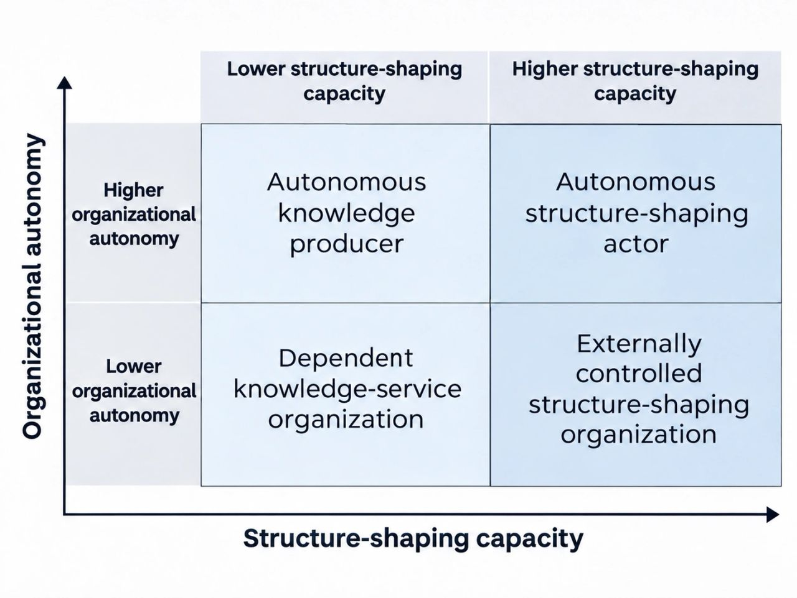

# Beyond the Adviser Role:

Original URL: https://epinova.org/f/beyond-the-adviser-role

Publication date: 2026-11-01

Archive note: This is a locally preserved Markdown copy of an EPINOVA article originally generated through the GoDaddy blog system.

---

[All Posts](<https://epinova.org/?blog=y>)

### Beyond the Adviser Role: 

November 1, 2026|Research Commentary

#### **Knowledge, Power, and Autonomous Agency in International Relations**

 _Rethinking the Position of Knowledge Producers in the Structures of Power_

  

  

**Author:** Dr. Shaoyuan Wu

**ORCID:** [_https://orcid.org/0009-0008-0660-8232_](<https://orcid.org/0009-0008-0660-8232>)

**Affiliation:** Global AI Governance and Policy Research Center, EPINOVA LLC

**Date:** November 1, 2026 

  

#### **Introduction: A Question Beyond Institutional Survival**

A colleague recently mentioned that an international security research institute within their organization was undergoing layoffs, prompting a skeptical remark about the professional prospects of international relations as a field.

Although personnel reductions at a single institution do not establish a broader disciplinary decline, the exchange raised a more fundamental question:

**Why do organizations devoted to understanding power, strategy, and international order often develop their capabilities around the objectives of established authorities, rather than acquiring the capacity to pursue and sustain objectives of their own?**

International Relations (IR) has developed sophisticated frameworks for explaining how power emerges, operates, and transforms international systems. Yet many organizations producing this knowledge remain primarily positioned as advisers, analysts, or consultants to actors possessing established political and institutional authority.

This arrangement is not inherently problematic. Advisory research can be independent, influential, and socially valuable. The concern arises when professional influence does not translate into the organizational capacity to determine and sustain independent courses of action.

This article examines that potential tension through the concept of the _adviser-role dilemma_ : the possibility that relationships generating policy influence and institutional resources may simultaneously reinforce organizational dependence and constrain the development of alternative capabilities.

The central question is not whether knowledge should become political power, but under what conditions knowledge-producing communities can form autonomous collective actors and contribute to shaping the structures they study.

  

#### **1\. The Adviser Role and the Formation of Collective Agency**

Throughout political history, advisers, strategists, and policy counselors have influenced decisions without necessarily controlling the authority or resources required to implement them.

Contemporary international affairs research frequently operates through comparable relationships. Research institutions identify emerging threats, develop strategic recommendations, and assess policy consequences, while governments, international organizations, and other authorities determine whether and how those recommendations are implemented.

Knowledge can nevertheless exercise considerable influence.

Haas (1992) demonstrates how epistemic communities shape international policy coordination through specialized expertise and shared causal understandings. Hendrix et al. (2023) similarly show that policy engagement is common among surveyed US-based international relations scholars.

However, policy engagement, policy influence, and autonomous organizational power are not equivalent.

An institution may influence major decisions while possessing limited discretion over its own institutional development. Conversely, another may maintain intellectual independence without substantially changing external political or institutional arrangements.

This distinction leads to a constitutive question: **How do dispersed knowledge producers become collective actors capable of defining objectives, mobilizing resources, and sustaining coordinated action?**

Shared expertise alone does not establish collective agency.

Ahrne and Brunsson (2011) demonstrate that organizational arrangements can emerge through combinations of membership, rules, decision-making authority, and other coordinating mechanisms. Such arrangements need not begin as fully developed formal organizations.

Professional communities may gradually acquire collective agency through joint projects, negotiated commitments, resource coordination, and institutional continuity.

Their development also depends on how professional success is defined.

Organizations may voluntarily prioritize research and consultation. Alternatively, recruitment, evaluation, and funding arrangements may systematically reward responsiveness to existing authorities while providing fewer incentives for independently initiated activities.

These possibilities must be distinguished from situations in which organizations seek greater autonomy but face contractual, financial, or institutional constraints.

The relevant question is therefore not whether advisory organizations already exercise agency—they do—but whether their accumulated capabilities remain available for objectives they can meaningfully determine.

  

#### **2\. Autonomy and the Capacity to Shape Structures**

Three concepts are essential to this distinction.

**Collective agency** refers to the ability to establish commitments, coordinate resources, and sustain collective activities.

**Organizational autonomy** concerns substantive discretion over objectives, resource allocation, and the initiation, modification, or termination of activities.

**Structure-shaping capacity** concerns the potential to produce durable changes in the rules, coordination arrangements, resource access, or practical choices available to other actors.

These dimensions may develop independently.

An organization can exercise substantial autonomy without significantly influencing external structures. Another may participate in consequential institutional changes while remaining dependent on external authorities.

Autonomy also does not require objectives to be established unilaterally. Negotiated goals may remain consistent with autonomous agency when an organization retains meaningful participation in determining them and discretion over its commitments.

This distinction is particularly important in international affairs, where collective action commonly involves multiple jurisdictions, authorities, and institutional relationships.

An organization may therefore occupy different positions according to its autonomy and structure-shaping capacity: an autonomous knowledge producer, a dependent knowledge-service organization, an externally controlled structure-shaping organization, or an autonomous structure-shaping actor.

These are analytical possibilities, not a hierarchy of institutional worth.

A further distinction concerns capacity and actual effects. Possessing the resources and expertise necessary to influence institutional arrangements does not guarantee that opportunities for such influence will arise. Conversely, a consequential policy contribution does not necessarily establish enduring structural capacity.

Strange (1988) emphasizes how security, production, finance, and knowledge constitute structures of power in international political economy. Barnett and Duvall (2005) further demonstrate that power operates through different social and institutional relationships.

Building on these insights, the present argument treats structure-shaping capacity as an analytically distinct dimension through which knowledge-producing organizations may affect the conditions under which other actors operate.

  

#### **3\. The Adviser-Role Dilemma: When Influence Reinforces Dependence**

The adviser-role dilemma concerns a potential conflict between strengthening established sources of professional influence and developing capabilities that expand future organizational choices.

Resource dependence theory provides an explanatory foundation. Pfeffer and Salancik (1978) demonstrate how organizations become subject to external influence when essential resources are controlled by other actors.

For international affairs research institutions, commissioned projects may generate revenue, expertise, reputation, and access to policymakers. These relationships can support institutional development.

Yet they may also encourage capability accumulation around external requirements.

An institution dependent on recurring contracts from a limited number of clients may prioritize specialized personnel, client-specific infrastructure, and narrowly defined deliverables.

Where intellectual assets cannot be reused independently and organizational resources cannot easily be redirected, successful advisory engagement may increase the cost of pursuing alternative objectives.

A possible reinforcing mechanism emerges:

**Client-dependent revenue → Client-specific capability accumulation → Higher organizational switching costs → Reinforced dependence.**

This is not an inevitable outcome.

Commissioned research may also generate transferable expertise, reusable intellectual assets, discretionary resources, and diversified networks.

Under favorable institutional conditions, the same relationships may support an alternative pathway:

**Advisory resources and networks → Transferable assets → Autonomous capability accumulation → Expanded organizational choices.**

The theoretical contribution of the adviser-role dilemma lies in distinguishing the conditions under which these divergent trajectories emerge.

An organization may gain immediate advantages by investing in established advisory relationships while limiting resources available for long-term independent development.

Alternatively, investment in autonomous capabilities may expand future possibilities while reducing short-term revenue or access to established decision-makers.

Contractual arrangements, intellectual property rights, governance safeguards, resource substitutability, and internal investment priorities may determine how these tensions develop.

The deeper problem is therefore not dependence itself, but whether **the mechanisms through which knowledge organizations achieve professional success also constrain their future capacity to determine and pursue independent objectives**.

  

#### **4\. From Autonomous Knowledge to Structural Change**

Autonomous collective agency does not automatically produce structural influence.

Knowledge organizations must also establish mechanisms through which their capabilities affect the institutional environments of other actors.

Such mechanisms may include analytical standards, risk classification systems, information infrastructures, or coordination procedures.

Their significance depends on external adoption and institutional embedding.

Organizations may adopt knowledge-based instruments because they reduce uncertainty, address coordination problems, improve interoperability, or offer credible foundations for collective decisions.

However, technical quality alone is insufficient.

Adoption also depends on legitimacy, institutional compatibility, implementation costs, competing arrangements, and the interests of established authorities.

Finnemore and Sikkink (1998) demonstrate how international norms gain influence through processes of persuasion, recognition, and institutionalization. Abbott et al. (2016) show how governance can operate through orchestration, mobilizing intermediaries and voluntary cooperation rather than relying exclusively on hierarchical authority.

These perspectives suggest a conditional pathway:

**Sustained organizational capabilities → Knowledge-based coordination instruments → External adoption → Institutional embedding → Durable structural effects.**

An instrument becomes structurally consequential when it changes recurring decisions, established rules, access to resources, or other durable conditions of action.

Such effects do not always require repeated adoption. A single consequential institutional change may produce persistent results.

Yet each transition can fail.

External actors may reject a proposal, replace it with competing arrangements, or adopt its outputs without preserving the originating organization's decision rights.

Even successful institutional adoption can generate new dependencies on funders, technical providers, institutional partners, or dominant users.

Consequently, structural influence and organizational autonomy may reinforce one another or develop in tension.

The critical distinction is between knowledge being used by others and knowledge-producing organizations retaining meaningful control over their own development as that use expands.

  

#### **5\. Institutional Implications**

Existing research organizations illustrate different aspects of these challenges.

Chatham House maintains formal principles intended to protect intellectual independence through institutional control over research, funding safeguards, and diversified financial relationships (Chatham House, 2024).

These provisions demonstrate how autonomy can be supported through governance arrangements, although their practical effectiveness requires separate evaluation.

ACLED provides another illustration. Through standardized conflict event data and continuing information services, it demonstrates how specialized knowledge can develop into sustained public information infrastructure (ACLED, 2023).

However, neither institutional independence nor the existence of an information platform automatically establishes structure-shaping effects.

Such claims require evidence of consequential adoption, institutional integration, and identifiable changes in other actors' decisions.

Two propositions follow.

**First** , commissioned relationships requiring substantial client-specific investment and restricting knowledge reuse may direct capability accumulation toward existing clients rather than independent organizational objectives.

**Second** , arrangements preserving discretionary resources, transferable knowledge assets, and substantive decision rights may enable policy engagement to support autonomous capability development.

Both propositions require empirical investigation.

Moreover, organizational autonomy must remain distinct from legitimacy and accountability. Research institutions acquiring greater structural influence may require stronger mechanisms for transparency, independent review, correction, and contestation.

Greater organizational independence should not come at the expense of the intellectual freedom of individual researchers or the rights of those affected by institutional decisions.

####   

#### **Conclusion**

The institutional layoff that prompted this reflection does not establish a crisis in International Relations. It nevertheless provides an opportunity to reconsider the position of knowledge-producing organizations within the structures of power they study.

The central problem is not whether scholars understand political power sufficiently well to exercise it.

Rather, it concerns how professional roles, resource relationships, and institutional arrangements shape the formation of autonomous collective agency.

The adviser-role dilemma identifies a potentially important mechanism: relationships generating policy influence may also direct capability accumulation toward externally defined objectives, narrowing future organizational choices.

Under different conditions, those same relationships may support independent capability development and new forms of collective action.

A further challenge concerns the translation of autonomous capabilities into enduring structural influence through external adoption and institutional change.

Neither greater autonomy nor greater structural influence should be treated as a universal objective for all research institutions.

What deserves systematic investigation is **why certain patterns of knowledge production reproduce established advisory roles, while others enable knowledge-producing communities to establish independent objectives, sustain collective action, and contribute to transforming international structures**.

Ultimately, the question extends beyond professional survival or institutional independence.

It concerns a fundamental relationship between knowledge and historical agency: **under what conditions can those who study the formation and operation of power acquire the collective capacity to participate autonomously in shaping the structures they seek to understand?**

#### **References**

Abbott, K. W., Genschel, P., Snidal, D., & Zangl, B. (2016). Two logics of indirect governance: Delegation and orchestration. _British Journal of Political Science, 46_(4), 719–729. <https://doi.org/10.1017/S0007123414000593>

ACLED. (2023). _What can ACLED data be used for? What should they not be used for?_ <https://acleddata.com/faq/what-can-acled-data-be-used-what-should-they-not-be-used>

Ahrne, G., & Brunsson, N. (2011). Organization outside organizations: The significance of partial organization. _Organization, 18_(1), 83–104. <https://doi.org/10.1177/1350508410376256>

Barnett, M., & Duvall, R. (2005). Power in international politics. _International Organization, 59_(1), 39–75. <https://doi.org/10.1017/S0020818305050010>

Chatham House. (2024). _Principles of independent research, convening and fundraising_. <https://www.chathamhouse.org/about-us/our-funding/principles-independent-research-convening-and-fundraising>

Finnemore, M., & Sikkink, K. (1998). International norm dynamics and political change. _International Organization, 52_(4), 887–917. <https://doi.org/10.1162/002081898550789>

Haas, P. M. (1992). Introduction: Epistemic communities and international policy coordination. _International Organization, 46_(1), 1–35. <https://doi.org/10.1017/S0020818300001442>

Hendrix, C. S., Macdonald, J., Powers, R., Peterson, S., & Tierney, M. J. (2023). The cult of the relevant: International relations scholars and policy engagement beyond the ivory tower. _Perspectives on Politics, 21_(4), 1270–1282. <https://doi.org/10.1017/S153759272300035X>

Pfeffer, J., & Salancik, G. R. (1978). _The external control of organizations: A resource dependence perspective_. Harper & Row.

Strange, S. (1988). _States and markets_. Pinter Publishers.

Share this post:
