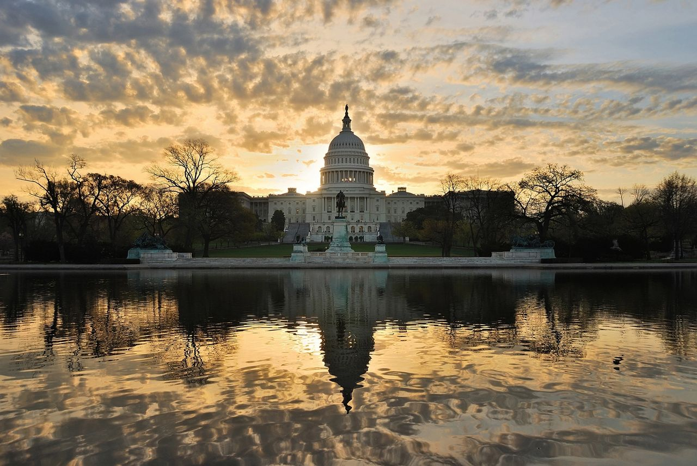

# The Limits of America’s Political Reset

Original URL: https://epinova.org/f/the-limits-of-america%E2%80%99s-political-reset

Publication date: undated

Archive note: This is a locally preserved Markdown copy of an EPINOVA article originally generated through the GoDaddy blog system.

---

[All Posts](<https://epinova.org/?blog=y>)

### The Limits of America’s Political Reset

November 4, 2026|Global AI Governance & Policy

**Author:** Dr. Shaoyuan Wu

**ORCID:** [_https://orcid.org/0009-0008-0660-8232_](<https://orcid.org/0009-0008-0660-8232>)

**Affiliation:** Global AI Governance and Policy Research Center, EPINOVA LLC

**Date:** November 4, 2026 

  

 _The midterms have changed Washington’s political balance. Fiscal deadlines, divided government, and inherited strategic commitments will determine how much can actually change._

  

Democrats’ victory in both chambers of Congress has changed the political balance in Washington. It promises stronger oversight of President Donald Trump, renewed disputes over federal spending, and greater congressional scrutiny of American foreign policy. Yet the election has not changed the economic and strategic problems confronting the country. Federal deficits, household costs, the war with Iran, and security commitments across multiple regions remain regardless of who controls the legislative agenda.

The central question is how quickly a change in political authority can produce a change in national strategy. The federal government faces a funding deadline before the new Congress takes office. A divided government will then confront competing domestic and international priorities, while the 2028 presidential election opens another debate over America's strategic direction.

These three political timetables intersect with a slower process of military production, equipment replenishment, and the management of existing security obligations. The Congressional Budget Office has warned that heavy use of missile-defense interceptors against Iran could leave relevant U.S. inventories diminished for several years. Political priorities may change within weeks, but the capabilities needed to implement them cannot necessarily recover at the same speed.

Washington therefore faces a problem extending beyond partisan disagreement: whether its institutions can adjust inherited strategic commitments while preserving the resources needed for future contingencies.

  

#### The First Clock: A Funding Deadline Before the Transfer of Power

The first challenge is the interval between electoral results and the transfer of congressional authority.

Democrats have won the next congressional majorities, but the new congressional terms begin on January 3, 2027. The current federal continuing resolution expires on December 11, leaving the outgoing Republican-controlled Congress to negotiate another funding arrangement.

The deadline matters beyond the possibility of a government shutdown. Under [Section 102 of Public Law 119-103](<https://www.govinfo.gov/content/pkg/PLAW-119publ103/html/PLAW-119publ103.htm>), certain Defense Department funds provided through the continuing resolution cannot support production of previously unfunded items or increases in production rates beyond levels sustained by fiscal year 2026 funding.

These restrictions apply to specified funds and activities, not automatically to every defense contract. Separately appropriated resources, existing authorities, and statutory exceptions remain relevant. Nevertheless, the provision illustrates how a temporary funding arrangement can affect decisions about expanding military production.

Another short extension could preserve the incoming majority's opportunity to reconsider spending priorities. If it maintained existing production restrictions, however, decisions to accelerate selected weapons programs might require new funding authority or exceptions. A full-year appropriations agreement could provide contractors with greater certainty while limiting the new Congress's immediate opportunity to revise priorities.

Neither outcome necessarily constitutes a strategic failure. The relevant question is which expenditures the outgoing Congress funds, which production decisions it leaves unresolved, and whether those choices affect the restoration of capabilities consumed in ongoing operations.

A short political transition can therefore influence military programs whose production and delivery schedules extend over several years.

  

#### The Second Clock: Divided Government and Strategic Adjustment

When Democrats assume congressional control, Trump will retain the presidency, executive authority, and the power to veto ordinary legislation. The new majority will gain committee leadership, investigative powers, greater influence over appropriations, and control of the Senate's confirmation agenda.

Their competing authorities will shape domestic spending, executive oversight, and the continuing conflict with Iran. But congressional efforts to constrain that conflict are already underway.

In June, [H.Con.Res. 86](<https://clerk.house.gov/Votes/2026199>), directing the removal of U.S. forces from hostilities with Iran subject to specified exceptions, passed the House by 215–208 and the Senate by 50–48. Another measure, H.Con.Res. 89, passed the House in July but [failed in the Senate](<https://www.senate.gov/legislative/LIS/floor_activity/09_24_2026_Senate_Floor.htm>) in September by 49–50.

These votes demonstrated congressional opposition to aspects of the war but did not resolve disputes over the resolutions' legal effect or executive compliance. Concurrent resolutions are not submitted for presidential signature; binding legislation imposing restrictions generally follows a different process and may face a presidential veto.

A Democratic Congress could intensify oversight, seek funding conditions, and pursue additional legislative measures. Yet it would still confront presidential resistance, legal disputes, and the need to assemble sufficient legislative support.

Such institutional competition serves an important constitutional purpose. Congressional scrutiny can expose questionable expenditure, challenge poorly justified commitments, and improve accountability. But it can also complicate decisions requiring predictable implementation over several years.

Annual appropriations, defense contracts, industrial expansion, military deployments, and equipment replenishment follow different schedules. Political uncertainty may delay procurement or strategic adjustments. Conversely, additional appropriations cannot immediately produce deployable weapons, trained personnel, or restored equipment readiness.

Both parties face many of the same underlying pressures: federal deficits, energy prices, industrial constraints, military readiness, and the economic consequences of international instability. Their disagreements concern how these burdens should be addressed and distributed.

The strategic consequence of divided government will depend on whether stronger oversight improves resource allocation or repeated confrontation postpones necessary decisions. Political friction does not automatically reduce national capacity. Its effects become significant when identifiable delays or policy changes impair the government's ability to meet essential requirements.

  

#### The Third Clock: The 2028 Election and Strategic Direction

The approaching 2028 presidential election introduces another source of uncertainty.

The midterms have intensified debate over the economic and political costs of America's international commitments. Domestic living costs, energy prices, military spending, and foreign-policy decisions are increasingly connected in the political debate.

These questions also expose disagreements within both major parties.

On November 4, Vice President JD Vance attributed Republican electoral losses primarily to the Iran war. Trump acknowledged that the conflict had imposed political costs but continued to defend the military operation. Their differing assessments reveal a debate over the political consequences of overseas engagement, although they do not establish a formal policy rupture.

For Republicans, the approaching post-Trump succession raises questions about reconciling military strength, alliance commitments, fiscal restraint, and domestic economic priorities.

Democrats face their own disagreements. In July, a House amendment concerning $3.3 billion in Foreign Military Financing for Israel divided Democratic lawmakers: 103 supported it, 98 opposed it, and 10 voted present. The vote demonstrates a substantial division over this specific assistance proposal, although it cannot establish each lawmaker's position on the broader Iran conflict.

These differences may influence the parties' foreign-policy platforms ahead of 2028. But the more consequential question extends beyond internal party competition.

Will the next political cycle redirect resources toward domestic priorities, preserve existing international commitments, or restructure those commitments through greater burden-sharing and selective adjustment?

These possibilities are not mutually exclusive. Domestic prosperity depends partly on international energy markets, trade routes, supply chains, and security conditions. Sustaining global commitments, meanwhile, requires fiscal, industrial, and military resources that could serve other purposes.

A future administration may redefine national priorities. It will still inherit obligations created under previous decisions.

  

#### The Strategic Commitments That Elections Cannot Erase

The underlying constraint across all three political phases is the persistence of strategic obligations.

Military deployments require sustainment. Bases and supporting infrastructure need protection and maintenance. Equipment consumed in operations may create future replenishment requirements, depending on capability needs and replacement choices. Security arrangements also influence allied planning, potentially increasing the costs of abrupt changes.

In my research on the limits of strategic reach, I describe the difficult-to-reverse future burden of earlier decisions as _commitment overhang_ : resource requirements that cannot be removed within a relevant planning period without significant cost, delay, or risk.

Past expenditure and future obligation must remain analytically distinct. An interceptor already used in combat represents historical consumption. Whether it should be replaced, what capability should replace it, and how much additional risk can be accepted are separate decisions.

The Iran conflict illustrates the distinction.

In September, the [Congressional Budget Office](<https://www.cbo.gov/publication/62756>) estimated approximately $38 billion in Defense Department costs associated with operations through August 1, including operational expenditures and equipment-replacement requirements. CBO emphasized the uncertainty surrounding its assessment.

A subsequent U.S. Central Command estimate, [reported in October](<https://www.cbsnews.com/news/iran-war-cost-centcom-47-billion/>), placed costs through October 16 at approximately $47.1 billion. The estimate included roughly $29 billion for munitions replacement, $11.9 billion in incremental operational costs, and $6.1 billion for lost equipment.

These figures cover different periods and reflect different estimating processes. Their difference should not be treated as a precise measure of additional cash expenditure.

For future strategic capacity, the more important distinctions concern costs already incurred, replacement requirements not yet funded, contractual obligations, expected delivery dates, and capabilities actually restored.

Military resources are not perfectly interchangeable. Financial authority can change more quickly than specialized production capacity. Missile-defense systems, naval assets, logistics networks, and industrial facilities may support requirements across multiple regions.

Sustained consumption in one theater can therefore increase pressure on other commitments when scarce capabilities are shared and replenishment is slow. But the severity of that pressure depends on remaining inventories, production schedules, reserve requirements, operational priorities, and available substitutes.

This is the significance of _strategic optionality_ : the ability to meet a specified new contingency within the required period while keeping essential existing responsibilities above an acceptable risk threshold.

Long replacement periods alone do not establish that the United States has already exhausted its strategic flexibility. A more consequential warning sign would be evidence that sustaining one commitment repeatedly requires delaying, reducing, or abandoning another defined requirement.

Even a sustained reduction in hostilities with Iran would not immediately restore consumed inventories or eliminate maintenance and procurement obligations already created.

The strategic question is therefore not merely how much Washington spends, but how much usable capacity remains available for what comes next.

##   

#### The Test of American Strategic Adjustment

The coming political transition offers an opportunity to make these constraints more visible.

Congress has already considered a detailed reporting mechanism. A [July House legislative text](<https://www.govinfo.gov/content/pkg/CREC-2026-07-21/pdf/CREC-2026-07-21-pt1-PgH4736.pdf>) included proposed Section 1089E, calling for information on the costs of Iran operations, weapons consumption, replacement valuations, infrastructure damage, and military readiness. Its inclusion in the House text does not by itself establish that it became law.

The next Congress could connect such reporting more directly to procurement and operational decisions.

For critical military systems, lawmakers could request four categories of information: quantities consumed, intended replacement levels, contracted delivery schedules, and equipment actually accepted into usable inventory. Where replenishment falls behind requirements, officials should identify the affected missions, available substitutes, and additional risk.

These measures would help distinguish a lengthy but manageable recovery process from a binding strategic constraint.

The same principle applies beyond defense procurement. Evaluating major international commitments requires consideration of expected strategic value, lifecycle costs, implementation periods, and their effects on capacity available for other priorities.

The next two years will test whether divided institutions can improve these assessments or whether political confrontation will make accumulated commitments harder to revise.

The three political phases will unfold regardless: a fiscal transition, divided government, and a presidential election that may redefine national priorities. What remains uncertain is whether those political changes can be translated into adjustments in resources, obligations, and operational capabilities.

American power will depend not only on the decisions its leaders make, but also on whether the country retains sufficient capacity to implement different decisions when circumstances change.

**An election can settle who will control Congress in a night. Rebuilding the capacity to change national strategy can take years.**

Share this post:
