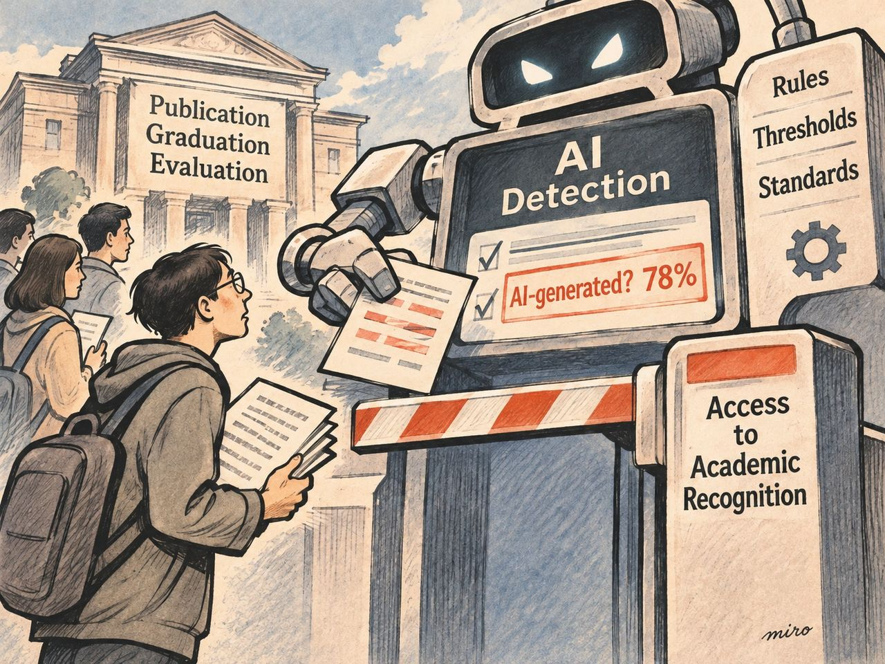

# Who Gets to Define Legitimate AI Use?

Original URL: https://epinova.org/f/who-gets-to-define-legitimate-ai-use

Publication date: undated

Archive note: This is a locally preserved Markdown copy of an EPINOVA article originally generated through the GoDaddy blog system.

---

[All Posts](<https://epinova.org/?blog=y>)

### Who Gets to Define Legitimate AI Use? 

November 17, 2026|Global AI Governance & Policy

#### **The Power Behind AI Governance**

**Author:** Dr. Shaoyuan Wu

**ORCID:** [_https://orcid.org/0009-0008-0660-8232_](<https://orcid.org/0009-0008-0660-8232>)

**Affiliation:** Global AI Governance and Policy Research Center, EPINOVA LLC

**Date:** November 17, 2026 

  

A recent controversy surrounding China National Knowledge Infrastructure (CNKI) raises a question that extends far beyond the reliability of AI-generated content detection.

According to a November 17 report by _The Paper_ , students and researchers have reported substantial changes in AI-generated content detection scores following an algorithm update by CNKI on October 24. Some claimed that texts written entirely by humans were flagged as potentially AI-generated, while identical manuscripts received markedly different results before and after the update. CNKI customer service acknowledged the algorithm upgrade but emphasized that detection results should be treated as references rather than definitive evidence of AI authorship.

Yet when universities and academic journals establish mandatory thresholds for AI-generated content, a deeper issue emerges: **When AI is used to determine whether others have used AI, are we merely regulating technology, or are we also redistributing authority over its legitimate use?**

Using AI to detect AI-generated content is not inherently contradictory. Academic institutions have legitimate reasons to address ghostwriting, fabricated references, and undisclosed AI assistance. The problem arises when probabilistic algorithmic judgments are converted into binding institutional requirements without sufficient transparency, independent validation, or meaningful opportunities for appeal.

At that point, AI detection is no longer merely a technical service. It becomes part of the institutional process through which academic work is evaluated, accepted, or rejected.

This transformation creates a distinctive form of power. Detection providers develop and modify the algorithms that generate assessments. Universities and journals establish the rules under which those assessments acquire institutional consequences. Students and researchers must then adjust their behavior to satisfy the resulting requirements.

Although formal decision-making authority remains with academic institutions, algorithm providers may indirectly influence the conditions of academic participation. A change in detection methodology can alter the practical difficulty of meeting institutional standards even when those standards themselves remain unchanged.

**The result is not necessarily market monopoly, but potentially a concentration of authority over evaluation standards and institutional access.**

The consequences may extend beyond individual publication or graduation decisions. When detection scores become decisive, researchers may begin optimizing their writing not for conceptual precision, evidentiary rigor, or argumentative coherence, but for compliance with an opaque algorithm.

What should be a process of developing research questions, examining evidence, and constructing arguments risks becoming a process of anticipating detection criteria, rewriting flagged passages, and repeatedly testing manuscripts. The reported practice of using AI tools to generate, detect, and then rewrite text illustrates this displacement of academic objectives.

A deeper paradox follows: **Humans initially adopted AI to support knowledge production, but they may increasingly find themselves adapting knowledge production to satisfy AI-based evaluation.**

This controversy reveals an underexamined dimension of AI power.

Competition over AI power is not confined to model capabilities, computing infrastructure, investment, or market dominance. It also concerns who defines legitimate AI use, who establishes the standards through which AI-related practices are evaluated, and who possesses the institutional authority to enforce those standards.

The ability to govern AI use can therefore become a source of AI power in its own right.

This does not mean that AI governance is inherently an instrument of monopoly or institutional domination. Its consequences depend on how authority is distributed, how technical judgments are validated, and whether affected individuals retain meaningful opportunities to contest decisions.

Effective governance must therefore examine not only the conduct of AI users but also the power exercised through AI governance tools themselves. Detection systems require independent validation, transparent accounts of their limitations, and procedures that prevent uncertain technical assessments from becoming unquestionable institutional judgments.

Ultimately, the CNKI controversy raises a question more fundamental than whether an AI detector can reliably identify machine-generated text:

**Who has the authority to determine how others may legitimately use AI, and what constrains that authority?**

AI governance is intended to establish legitimate boundaries for technological use. Yet when those boundaries are increasingly shaped by opaque and difficult-to-challenge algorithmic assessments, governance itself may become a mechanism of power concentration.

**The power to govern AI use is becoming an important dimension of AI power itself.**

Share this post:
